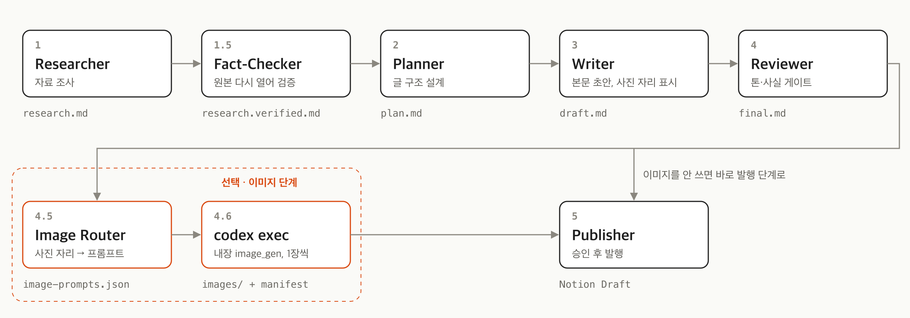
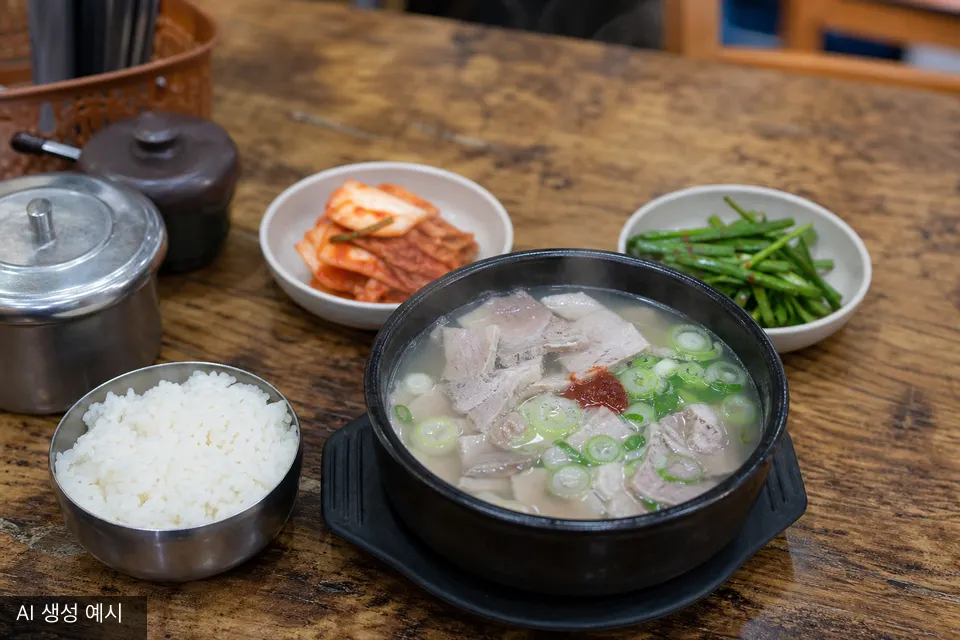

# blog-posting-auto

Claude Code 기반 한국어 블로그 글 자동화 파이프라인. 주제 한 줄을 던지면 6개 서브에이전트가 직렬로 돌아 사실 검증된 블로그 글 한 편을 만들어 Notion DB에 Draft로 발행한다.



Reviewer 뒤에 이미지 단계를 선택으로 붙일 수 있다. 글 안의 `📸 [설명]` 자리마다 Codex CLI(`codex exec`)가 섹션 이미지를 한 장씩 만든다. 자세한 내용은 [이미지 단계](#이미지-단계-선택) 참고.

```
사용자 입력 → Researcher → Fact-Checker → Planner → Writer → Reviewer → (Image Router → codex exec) → Publisher → Notion Draft
                  ↓             ↓ 환각·오인용 격리
              research.md   research.verified.md  (downstream의 유일한 사실 진실원)
                            research.rejected.md  (탈락 audit)
```

다른 블로그 자동화 파이프라인과 다른 점은 **Fact-Checker 단계**. Researcher가 모은 사실을 원본 URL 재방문으로 매치 검증해 통과한 것만 verified로 격리한다. Writer는 verified만 본다. 1인칭 경험담 우회로로 환각이 통과되는 문제를 차단.

## 6단계 구성

| # | 에이전트 | 모델 | 입력 | 출력 |
|---|---------|------|------|------|
| 1 | blog-researcher | haiku | 주제 | `research.md` |
| 1.5 | blog-fact-checker | sonnet | `research.md` | `research.verified.md`, `research.rejected.md` |
| 2 | blog-planner | sonnet | `research.verified.md` | `plan.md` |
| 3 | blog-writer | sonnet | `plan.md`, `research.verified.md` | `draft.md` |
| 4 | blog-reviewer | opus | `draft.md` | `final.md` |
| 4.5 | blog-image-router (선택) | sonnet | `final.md`, `research.verified.md` | `image-prompts.json` |
| 4.6 | `scripts/codex-images.sh` (선택) | Codex CLI 기본 모델 | `image-prompts.json` | `images/*.png`, `images.manifest.json` |
| 5 | blog-publisher | haiku | `final.md` | Notion page URL |

각 단계 결과물은 `workspace/{RUN_ID}/`에 떨어지고 오케스트레이터가 단계별 검증을 책임진다. Fact-Checker verified 비율이 50% 미만이면 자동으로 Researcher를 다시 돌린다 (최대 2회).

## 사전 요구사항

- **Claude Code** (CLI 또는 IDE 확장) — `claude` 명령으로 세션 시작
- **Notion MCP 연결** — `claude_ai_Notion` 글로벌 MCP 서버 설정 ([Anthropic Notion connector 가이드](https://docs.anthropic.com/) 참조)
- **Notion DB 1개** — 글이 쌓일 데이터베이스. title 속성 1개만 있어도 동작 (기본 필드명 `이름`)
- **이미지 단계를 쓸 때만**: Codex CLI와 `jq`. codex-cli 0.163.0에서 확인했다. `OPENAI_API_KEY`는 필요 없다.
  ```bash
  codex login                                   # ChatGPT 계정으로 로그인
  codex login status                            # "Logged in using ChatGPT"
  codex features list | grep image_generation   # stable  true
  ```

## 설치

```bash
git clone <this-repo>
cd blog-posting-auto

cp .env.example .env
# .env 열어서 NOTION_PARENT_PAGE_ID, NOTION_DATABASE_ID 채우기
```

### Notion ID 찾는 법

Notion DB 우상단 `···` → `Copy link` → URL 마지막 32자 hex가 ID.

```
https://www.notion.so/your-workspace/My-DB-abcdef0123456789abcdef0123456789
                                          └──────── DB ID ────────┘
```

부모 페이지 ID도 같은 방식. DB가 inline DB라면 부모 페이지는 DB가 박혀 있는 그 페이지.

## 사용

이 폴더에서 Claude Code 세션 시작 후:

```
/blog-pipeline 부산 돼지국밥 맛집 후기
```

또는

```
/blog-pipeline chatgpt vs claude 2026 비교
```

스킬이 자동으로:

1. `workspace/{YYYYMMDD-HHMMSS-slug}/` 디렉토리 생성
2. 6단계 직렬 실행, 단계별 검증
3. 최종 발행 직전 사용자에게 미리보기 1줄 보여주고 명시 OK 받기
4. OK 받으면 Notion DB에 Draft 페이지 생성

이미지까지 만들려면 `/blog-pipeline 부산 돼지국밥 맛집 후기 --images`처럼 요청하면 된다.

발행 단계는 **항상 명시 승인 필요**. 자동 발행 금지 (외부 노출 작업은 사용자 확인 필수).

## 이미지 단계 (선택)

Writer는 사진이 들어갈 자리에 `📸 [설명]`을 남긴다. Reviewer가 `final.md`를 확정한 뒤 두 단계가 이어진다.

1. **4.5 blog-image-router**: placeholder마다 섹션 제목과 본문, `research.verified.md`를 읽고 영어 프롬프트를 `image-prompts.json`에 쓴다. 간판·로고·글자·사람 얼굴·확인 안 된 디테일은 넣지 않는다.
2. **4.6 `scripts/codex-images.sh generate`**: 항목마다 `codex exec`를 한 번씩, 한 번에 하나만 실행한다. Codex 내장 `image_gen`이 ChatGPT 로그인으로 이미지를 만들고, 스크립트는 PNG 파일이 실제로 생겼는지로 성공을 판정한다.

```bash
scripts/codex-images.sh generate workspace/$RUN_ID < /dev/null
```

결과는 `workspace/{RUN_ID}/images/*.png`와 `images.manifest.json`이다. manifest 항목은 `section_heading`, `source_placeholder`, `prompt`, `negative_constraints`, `filename`, `status`(`generated` 또는 `failed`)를 가진다. 다른 모델을 쓰려면 `CODEX_IMAGE_MODEL`을 지정한다. 비우면 `~/.codex/config.toml` 기본 모델을 쓴다.

**`final.md`는 고치지 않는다.** 이미지를 확인한 뒤 `scripts/codex-images.sh swap workspace/$RUN_ID`를 실행하면 placeholder 줄을 ``로 바꾼 사본 `final.images.md`가 생긴다. 실패한 항목의 placeholder는 그대로 남는다. Notion은 로컬 이미지 경로를 읽지 못해서, Publisher는 지금처럼 `final.md`를 발행하고 이미지는 Notion 페이지에 직접 올려야 한다.

이미지 한 장에 30초에서 몇 분이 걸리고, ChatGPT 계정 사용량을 쓴다.

| | |
|---|---|
|  |  |

AI 생성 예시. 부산 돼지국밥 글의 섹션 placeholder로 Codex `image_gen`이 만든 일러스트이고, 글에 나온 실제 가게의 음식이나 매장 사진이 아니다.

## 디렉토리 구조

```
.
├── .claude/
│   ├── agents/              7개 서브에이전트 정의 (image-router 포함)
│   ├── skills/blog-pipeline/  /blog-pipeline 슬래시 스킬
│   ├── style/               톤·금지표현·체크리스트
│   └── hooks/               SessionStart/UserPromptSubmit/PreToolUse/SubagentStop/Stop
├── scripts/codex-images.sh  이미지 단계 (generate / swap)
├── docs/images/             README 이미지
├── examples/                참고 글 샘플 5편 (스타일 학습용)
├── workspace/{run_id}/      실행별 산출물 (gitignored)
├── .env.example             환경 변수 템플릿
└── CLAUDE.md                프로젝트 컨텍스트
```

## 스타일 가이드

`.claude/style/` 4개 파일이 모든 에이전트의 톤을 통제:

- `voice.md` — 한국어 보이스 규칙
- `readability.md` — 문장 길이·어절·리듬
- `forbidden.md` + `forbidden.patterns` — 금지표현. PreToolUse hook이 Write/Edit 직전 자동 grep으로 차단
- `checklist.md` — Reviewer 최종 체크리스트

자기 톤에 맞게 4개 파일만 갈아끼우면 다른 글쓰기 스타일로 재활용 가능. 예: 영어 블로그용, 기술 튜토리얼 톤, 에세이 톤.

## 커스터마이징

### Notion DB 스키마 확장

기본은 title 필드 1개. 다음 속성을 DB에 추가하고 `.env`에 매핑하면 자동 채워짐:

- `NOTION_DB_STATUS_FIELD` + `NOTION_DB_STATUS_DRAFT_VALUE` — Status 속성 (예: `상태` / `Draft`)
- `NOTION_DB_CATEGORY_FIELD` — 카테고리 (Select)
- `NOTION_DB_TAGS_FIELD` — 태그 (Multi-select). **기존 옵션만 사용**, 새 옵션 자동 생성 시 발행 실패

빈 값이면 publisher가 해당 매핑을 스킵.

### 모델 교체

`.claude/agents/blog-*.md` 각 파일 frontmatter의 `model:` 필드 수정. 기본은 비용·품질 트레이드오프 기준:

- haiku — Researcher, Publisher (검색·MCP 호출 등 정형 작업)
- sonnet — Fact-Checker, Planner, Writer (사실 검증·구조·본문)
- opus — Reviewer (톤·금지표현·가독성 게이트)

### 다른 발행 타겟

현재는 Notion 전용. WordPress / Ghost / Tistory 등 다른 타겟이 필요하면 `.claude/agents/blog-publisher.md`를 새 어댑터로 갈아끼우면 됨. final.md는 표준 마크다운이라 어디든 갈 수 있음.

## 핵심 규칙

1. 각 에이전트는 자기 출력 파일만 생성. 이전 단계 파일은 read-only.
2. Planner 이후 단계는 `research.verified.md`만 사실 소스로 사용. `research.md`(원본)는 참고용.
3. Reviewer는 draft.md를 final.md로 복제 후 편집 — draft.md 보존.
4. Publisher는 명시적 사용자 승인 후에만 실행.
5. 모든 에이전트는 한국어 본문 작성. 영어 직역체·번역투 금지.
6. Writer는 1인칭 경험담에도 측정 가능한 디테일(지명·거리·시간·가격·브랜드) 임의 추가 금지. verified에 있을 때만 구체값 사용.
7. 모든 자료 조사·검증은 실행 날짜 기준. time-sensitive 사실은 출처 12개월 초과면 stale-source로 reject.
8. 이미지 단계는 선택. `final.md`는 그대로 두고, placeholder 교체는 `final.images.md` 사본에만 한다. 실존 가게 이미지는 AI 일러스트로만 만들고 그렇다고 밝힌다.

## 디버깅

각 단계 실패는 `workspace/{RUN_ID}/meta.json`에 기록.

- Fact-Checker verified 비율 < 50%면 자동 RETRY 후에도 실패하면 사용자에게 결정 요청
- `research.rejected.md`에서 어떤 주장이 왜 떨어졌는지 audit
- 금지표현 grep 매치는 Writer 단계에서 빈번. `.claude/style/forbidden.patterns` 정규식 확인

## 라이선스

MIT. 자유롭게 fork·수정 가능.

## 기여

스타일 가이드 (`.claude/style/`) 갈아끼우기, 다른 발행 타겟 어댑터 추가, 에이전트 모델 매핑 개선 등 PR 환영.
